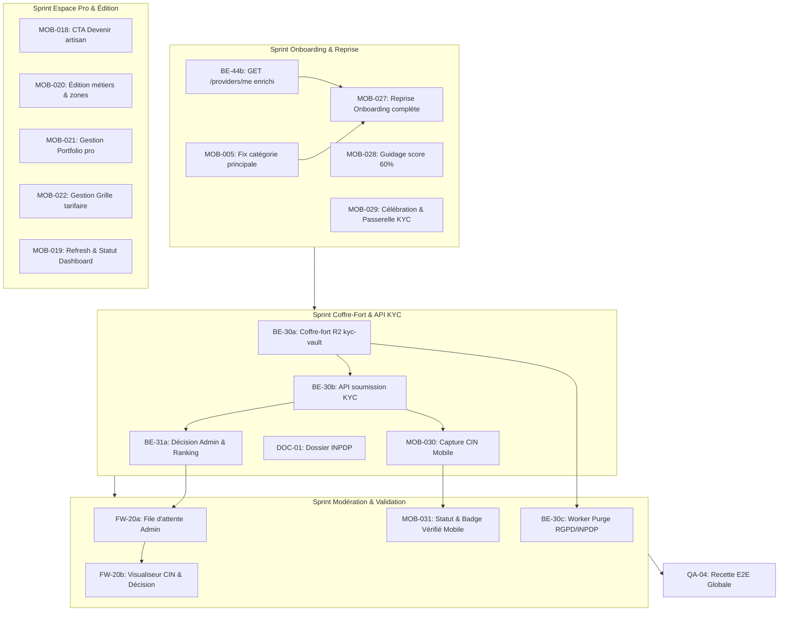

# Backlog Spécifique : Finalisation de l'Onboarding Pro & Système de Vérification (KYC)

> **Projet :** Sanaya — Plateforme de mise en relation d'artisans en Tunisie  
> **Cadre méthodologique :** Agile / Scrum · Estimation en Story Points (Fibonacci) et Heures-homme  
> **Conformité & Décisions clés :** ADR-001 (Flutter / OpenAPI), ADR-002 (Badge vérifié gratuit fondé sur la CIN), Loi organique tunisienne n° 2004-63 (Protection des données personnelles / INPDP)  
> **Branche de travail recommandée :** `develop` via branches de fonctionnalités préfixées

---

## 1. Synthèse & Vue d'Ensemble

Ce backlog recense de manière exhaustive toutes les tâches requises pour :
1. **Sécuriser et parachever l'onboarding de l'artisan** (reprise après coupure sans perte, réassignation défensive des métiers, guidage interactif vers les 60 % de complétude, transition post-publication).
2. **Déployer le système complet de vérification d'identité (KYC / CIN)** permettant l'attribution du label de confiance **« Artisan Vérifié »** conformément à l'ADR-002.
3. **Mettre en place le coffre-fort numérique sécurisé** (Cloudflare R2 privé, chiffrement SSE, URLs éphémères de 5 min, traçabilité `AuditLog`).
4. **Construire la file de modération back-office** (`apps/admin`) pour le traitement rapide et conforme des pièces d'identité.
5. **Régler la gestion opérationnelle post-onboarding** (mise à jour des métiers, zones, galerie de réalisations et grille tarifaire).

---

## 2. Matrice Récapitulative des Tâches

| ID | Domaine | Epic / Thématique | Intitulé de la tâche | Prio | Est. | Dépendances | Statut |
| :---: | :---: | :--- | :--- | :---: | :---: | :---: | :---: |
| **BE-44b** | Backend | Onboarding Pro | Enrichissement de `GET /v1/providers/me` (catégories, zones, portfolio) | 🔴 P0 | 3 h | BE-44 | ✅ Fait |
| **MOB-005** | Mobile | Onboarding Pro | Réassignation automatique de la catégorie principale en dé-sélection | 🔴 P0 | 2 SP | — | À faire |
| **MOB-027** | Mobile | Onboarding Pro | Reprise intégrale de session d'onboarding sans perte de saisie | 🔴 P0 | 3 SP | BE-44b |
| **MOB-028** | Mobile | Onboarding Pro | Guidage interactif vers les 60 % (liens directs champs manquants) | 🟠 P1 | 3 SP | — | ✅ Fait |
| **MOB-029** | Mobile | Onboarding Pro | Écran de célébration post-publication & passerelle vers la vérification | 🟠 P1 | 2 SP | — |
| **BE-30a** | Backend/Infra | Vérification & KYC | Coffre-fort numérique Cloudflare R2 privé chiffré (`kyc-vault.ts`) | 🔴 P0 | 4 h | BE-20a |
| **BE-30b** | Backend | Vérification & KYC | Routes API de soumission KYC (`presign`, `submit`, `status`) | 🔴 P0 | 5 h | BE-30a |
| **MOB-030** | Mobile | Vérification & KYC | Tunnel de capture & soumission CIN (recto/verso, n° CIN, accord INPDP) | 🔴 P0 | 5 SP | BE-30b |
| **MOB-031** | Mobile | Vérification & KYC | Module & tuiles de suivi du statut de vérification (Dashboard & Profil) | 🔴 P0 | 3 SP | MOB-030 |
| **FW-20a** | Admin Web | Modération | File d'attente back-office des vérifications CIN (`apps/admin`) | 🔴 P0 | 5 SP | BE-30b |
| **FW-20b** | Admin Web | Modération | Interface d'instruction CIN (visualiseur sécurisé, validation / rejet motivé) | 🔴 P0 | 5 SP | FW-20a |
| **BE-31a** | Backend | Modération | Traitement de la décision admin, mise à jour `isVerified` & recalcul ranking | 🔴 P0 | 3 h | BE-30b |
| **BE-30c** | Backend/Worker | Sécurité & Légal | Worker de purge automatique des documents sensibles post-décision | 🟠 P1 | 3 h | BE-30a |
| **DOC-01** | Conformité | Sécurité & Légal | Dossier de conformité INPDP (déclaration de traitement données sensibles) | 🔴 P0 | 8 h | — |
| **MOB-018** | Mobile | Espace Pro | Entrée visible "Devenir artisan" dans le profil client | 🟠 P1 | 2 SP | MOB-001 |
| **MOB-020** | Mobile | Espace Pro | Interface d'édition post-onboarding des catégories et zones pro | 🟡 P2 | 5 SP | BE-44b |
| **MOB-021** | Mobile | Espace Pro | Gestion autonome du portfolio dans le profil pro (ajout/suppression) | 🟡 P2 | 5 SP | MOB-020 |
| **MOB-022** | Mobile | Espace Pro | Module de consultation et édition des prestations & tarifs indicatifs | 🟡 P2 | 5 SP | BE-47 |
| **MOB-019** | Mobile | Espace Pro | Pull-to-refresh et sélecteur de disponibilité sur le Dashboard Pro | 🟡 P2 | 2 SP | — |
| **QA-04** | QA / Test | Recette | Scénarios de tests E2E : Inscription → Onboarding → KYC → Validation admin | 🔴 P0 | 4 h | Toutes |

---

## 3. Détail Exhaustif des Tâches par Épique

---

### EPIC 1 : Finalisation & Robustesse de l'Onboarding Pro

#### BE-44b : Enrichissement de `GET /v1/providers/me` pour la reprise d'onboarding
* **ID :** `BE-44b`
* **Lot :** Backend (`apps/api`, `packages/validators`, `packages/db`)
* **Priorité :** 🔴 P0 (Bloquant pour la continuité de parcours)
* **Estimation :** 3 h
* **Dépendances :** `BE-44`
* **Contexte & Problème :**  
  Aujourd'hui, `providerMeSchema` ne renvoie que les champs de base et le score de complétude. Les associations `categories`, `coverageAreas` et `portfolioItems` déjà sauvegardées lors des étapes 2, 3 et 4 ne sont pas exposées. Si l'artisan quitte l'application ou perd sa connexion en cours de route, il doit systématiquement resaisir ses métiers et ses zones d'intervention.
* **Périmètre technique :**
  1. Étendre `providerMeSchema` (`packages/validators/src/provider.ts`) avec :
     - `categories: z.array(providerCategoryResponseSchema)`
     - `coverageAreas: z.array(providerCoverageAreaResponseSchema)`
     - `portfolio: z.array(portfolioItemResponseSchema)`
  2. Mettre à jour `findProviderProfileByUserId` dans `packages/db` pour inclure ces relations.
  3. Régénérer le contrat OpenAPI (`pnpm --filter api openapi:generate`) et le client Dart (`pnpm mobile:gen`).
* **Critères d'acceptation :**
  - Un appel authentifié à `GET /v1/providers/me` renvoie les tableaux complets des catégories, zones et photos déjà rattachées.
  - La suite de tests d'intégration backend passe à 100 %.
  - Le client Dart compile sans aucune régression.
* **Statut :** ✅ **Fait** — Schémas validators mis à jour, `ownerProfileSelect` + mapping `toOwnerProfile()` dans `provider-profile.repository.ts`, contrat OpenAPI et clients web & Dart régénérés et synchronisés (`api:contract:check`, `mobile:client:check`), tests unitaires API et Flutter verts (onboarding 102/102, pro_profile 16/16).

---

#### MOB-005 : Réassignation automatique de la catégorie principale
* **ID :** `MOB-005`
* **Lot :** Frontend Mobile (`apps/mobile`)
* **Priorité :** 🔴 P0
* **Estimation :** 2 SP
* **Dépendances :** Aucune
* **Fichiers :** `lib/features/onboarding/presentation/widgets/onboarding_categories_step.dart`
* **Contexte & Problème :**  
  L'API exige strictement qu'exactement une catégorie soit marquée comme principale (`isPrimary: true`). Si l'artisan décoche la tuile qui portait l'étoile principale tout en laissant d'autres catégories cochées, le payload envoyé ne contient plus aucune catégorie principale, déclenchant une erreur HTTP 422 (`VALIDATION_ERROR`).
* **Critères d'acceptation :**
  1. Si la catégorie principale est désélectionnée, la première catégorie restante dans la liste est automatiquement promue `isPrimary: true`.
  2. L'indicateur visuel d'étoile / badge principal se met à jour instantanément sans action manuelle requise.
  3. La désélection de toutes les catégories désactive le bouton "Continuer".
  4. Test unitaire widget simulant la désélection avec vérification de l'état résultant.

---

#### MOB-027 : Reprise intégrale de session d'onboarding (Auto-Resume)
* **ID :** `MOB-027`
* **Lot :** Frontend Mobile (`apps/mobile`)
* **Priorité :** 🔴 P0
* **Estimation :** 3 SP
* **Dépendances :** `BE-44b`
* **Fichiers :**
  * `lib/features/onboarding/application/onboarding_notifier.dart`
  * `lib/features/onboarding/presentation/onboarding_screen.dart`
* **Description :**  
  Exploiter les données complètes de `GET /v1/providers/me` (fournies par BE-44b) pour positionner l'artisan directement à la première étape non complétée lors du relancement de l'application :
  - Profil incomplet -> Étape 1 (Profil)
  - Profil complet mais aucune catégorie -> Étape 2 (Catégories)
  - Catégories saisies mais aucune zone -> Étape 3 (Zones)
  - Zones saisies mais aucune photo -> Étape 4 (Photos)
  - Score ≥ 60 % mais non publié -> Étape 5 (Récapitulatif)
* **Critères d'acceptation :**
  1. Pré-remplissage immédiat de `_categorySelection` et `_zoneSelection` avec les identifiants distants.
  2. Aucun formulaire vide affiché si l'artisan a déjà saisi des informations.
  3. Navigation fluide avec `AppSkeleton` pendant le chargement initial.
* **Statut :** ✅ **Fait** — Reprise intelligente avec `determineResumeStep()` et réhydratation automatique des sélections de catégories, zones et tâches de portfolio existantes. Préservation de l'état local au retour arrière. Tests unitaires (30/30) et d'intégration écran (9/9) validés.

---

#### MOB-028 : Guidage interactif vers les 60 % de complétude
* **ID :** `MOB-028`
* **Lot :** Frontend Mobile (`apps/mobile`)
* **Priorité :** 🟠 P1
* **Estimation :** 3 SP
* **Dépendances :** Aucune
* **Fichiers :** `lib/features/onboarding/presentation/widgets/onboarding_summary_step.dart`
* **Description :**  
  Transformer la liste passive des `missingKeys` (bio trop courte, absence de slogan, etc.) en éléments cliquables permettant à l'artisan de sauter directement vers l'écran concerné pour corriger le point manquant sans devoir appuyer plusieurs fois sur "Précédent".
* **Critères d'acceptation :**
  1. Chaque champ manquant affiche une tuile d'action claire ("Ajouter une description de 50 caractères min", "Indiquer vos années d'expérience").
  2. Un tap sur la tuile navigue directement à l'étape correspondante (`OnboardingStep.profile`, etc.).
  3. Une jauge visuelle dynamique (code couleur : rouge < 40 %, orange 40-59 %, vert ≥ 60 %) illustre la progression.
* **Statut :** ✅ **Fait** — Tuiles d'action interactives avec navigation directe vers chaque étape cible manquante (`goToStep`), jauge de score dynamique trichrome (< 40 % `destructive`, 40-59 % `amber`, ≥ 60 % `verified`) avec statut textuel explicatif. Clés i18n FR/AR complètes et tests 100 % validés (14/14 widget, 31/31 notifier).

---

#### MOB-029 : Écran de célébration post-publication & passerelle vers la vérification
* **ID :** `MOB-029`
* **Lot :** Frontend Mobile (`apps/mobile`)
* **Priorité :** 🟠 P1
* **Estimation :** 2 SP
* **Dépendances :** Aucune
* **Description :**  
  Remplacer la redirection abrupte vers `/pro/dashboard` par un écran de félicitations chaleureux ("Mabrouk ! Votre profil est en ligne"). Cet écran met en avant l'étape suivante incontournable : la demande de vérification d'identité pour obtenir le **Badge Vérifié** et multiplier par 3 ses chances de contact.
* **Critères d'acceptation :**
  1. Illustration de succès avec confirmation que le profil est visible des clients.
  2. CTA principal : "Faire vérifier mon identité maintenant" (ouvre le flux KYC `MOB-030`).
  3. CTA secondaire : "Accéder à mon tableau de bord" (`/pro/dashboard`).
  4. Localisation parfaite en Arabe tunisien et Français.

---

### EPIC 2 : Système de Vérification d'Identité & Badge Vérifié (KYC Mobile)

#### MOB-030 : Tunnel de capture & soumission de la CIN tunisienne
* **ID :** `MOB-030`
* **Lot :** Frontend Mobile (`apps/mobile`)
* **Priorité :** 🔴 P0
* **Estimation :** 5 SP
* **Dépendances :** `BE-30b`
* **Fichiers :**
  * `lib/features/verification/presentation/screens/kyc_submission_screen.dart`
  * `lib/features/verification/data/kyc_repository.dart`
  * `lib/features/verification/presentation/widgets/cin_capture_card.dart`
* **Description :**  
  Interface guidée permettant à l'artisan de numériser sa Carte d'Identité Nationale (CIN) tunisienne :
  - Capture photo Recto et Verso avec gabarit de cadrage (guides visuels).
  - Compression locale sécurisée (JPEG qualité 85 %, max 1920x1080) avant envoi.
  - Saisie du numéro de CIN (exactement 8 chiffres) et de la date de délivrance.
  - Case à cocher obligatoire de consentement explicite au traitement des données d'identité conformément à la loi tunisienne n° 2004-63.
  - Téléversement direct et sécurisé vers Cloudflare R2 privé via URLs pré-signées.
* **Critères d'acceptation :**
  1. Contrôle de surface sur le numéro CIN : exactement 8 chiffres numériques.
  2. Interdiction de soumettre si l'une des deux faces (recto/verso) est manquante.
  3. Case à cocher de consentement légal obligatoire (avec lien vers les mentions INPDP).
  4. Gestion irréprochable des états de chargement (progression en % de l'upload) et d'erreur réseau.

---

#### MOB-031 : Module & tuiles de suivi du statut de vérification
* **ID :** `MOB-031`
* **Lot :** Frontend Mobile (`apps/mobile`)
* **Priorité :** 🔴 P0
* **Estimation :** 3 SP
* **Dépendances :** `MOB-030`, `BE-30b`
* **Fichiers :**
  * `lib/features/dashboard/presentation/widgets/verification_banner.dart`
  * `lib/features/pro_profile/presentation/widgets/verification_status_card.dart`
* **Description :**  
  Composants d'affichage dans le Dashboard Pro et le Profil Pro informant l'artisan de l'état de sa demande :
  - `NOT_SUBMITTED` : Bannière incitative avec bouton "Obtenir le badge Artisan Vérifié".
  - `PENDING` : Badge orange "Vérification en cours par l'équipe Sanaya (délai moyen 24 h)".
  - `APPROVED` : Badge vert officiel "✓ Artisan Vérifié" avec date de validation.
  - `MORE_INFO_REQUIRED` : Alerte orange avec message de l'administrateur + bouton pour téléverser une photo plus nette.
  - `REJECTED` : Alerte rouge avec motif du refus et possibilité de formuler une nouvelle demande.
* **Critères d'acceptation :**
  1. Actualisation réactive de l'état lors d'un pull-to-refresh sur le Dashboard.
  2. Le badge `VerifiedBadge` apparaît immédiatement sur le header de profil dès que `isVerified == true`.
  3. L'UI en arabe (RTL) est mise en page sans débordement de texte.

---

### EPIC 3 : Sécurisation Backend & Coffre-Fort Numérique (R2 KYC Vault & API)

#### BE-30a : Coffre-fort numérique Cloudflare R2 privé (`kyc-vault.ts`)
* **ID :** `BE-30a`
* **Lot :** Backend (`packages/storage`, `packages/db`)
* **Priorité :** 🔴 P0
* **Estimation :** 4 h
* **Dépendances :** `BE-20a`
* **Fichiers :** `packages/storage/src/kyc-vault.ts`
* **Description :**  
  Implémenter le module de stockage sécurisé pour les documents d'identité dans le bucket `private-kyc` :
  - Chiffrement au repos côté serveur (SSE-S3 / AES-256).
  - Aucune exposition sur CDN public (pas de sous-domaine public, bucket 100 % fermé).
  - Génération d'URLs PUT pré-signées à validité stricte de 10 minutes pour le téléversement direct depuis l'application mobile.
  - Génération d'URLs GET pré-signées éphémères à validité stricte de **5 minutes maximum** pour l'examen par les administrateurs.
* **Critères d'acceptation :**
  1. Toute tentative d'accès anonyme ou via URL directe sans signature renvoie un HTTP 403 Forbidden.
  2. L'URL de lecture expire physiquement après 300 secondes.
  3. Tests unitaires automatisés validant les délais d'expiration et la configuration du bucket privé.

---

#### BE-30b : Routes API de soumission et consultation KYC
* **ID :** `BE-30b`
* **Lot :** Backend (`apps/api`, `packages/validators`, `packages/db`)
* **Priorité :** 🔴 P0
* **Estimation :** 5 h
* **Dépendances :** `BE-30a`
* **Périmètre des routes :**
  1. `POST /v1/providers/me/kyc/presign` :
     - Vérifie l'authentification et le rôle `PROVIDER`.
     - Génère 2 clés de stockage privées (`kyc/{providerId}/{requestId}/recto.jpg`, `verso.jpg`).
     - Renvoie les URLs pré-signées de téléversement.
  2. `POST /v1/providers/me/kyc/submit` :
     - Valide le corps de requête : `cinNumber` (8 chiffres), `cinIssueDate`, `frontMediaId`, `backMediaId`, `consentInpdp: true`.
     - Crée ou met à jour l'enregistrement `VerificationRequest` en statut `PENDING`.
     - Met à jour `ProviderProfile.verificationStatus = PENDING`.
  3. `GET /v1/providers/me/kyc/status` :
     - Renvoie l'état courant, la date de soumission, le motif éventuel de rejet ou de demande de complément.
* **Critères d'acceptation :**
  1. Validation Zod stricte du numéro de carte d'identité (expression régulière `^\d{8}$`).
  2. Rejet immédiat avec HTTP 400 si `consentInpdp !== true`.
  3. Tests d'intégration Fastify couvrant le cycle complet d'initiation et de soumission.

---

#### BE-31a : Décision d'administration, audit et recalcul du ranking
* **ID :** `BE-31a`
* **Lot :** Backend (`apps/api`, `packages/core`, `packages/db`)
* **Priorité :** 🔴 P0
* **Estimation :** 3 h
* **Dépendances :** `BE-30b`
* **Description :**  
  Route réservée au rôle `ADMIN` : `POST /v1/admin/verifications/:id/decision`.
  - Décisions supportées : `APPROVE`, `REJECT`, `REQUEST_INFO`.
  - En cas d'approbation (`APPROVE`) :
    - `verificationStatus` passe à `APPROVED`.
    - `isVerified` passe à `true`.
    - `verifiedAt` est horodaté à `now()`.
    - Le `rankingScore` du profil est automatiquement recalculé (en intégrant le bonus `w3 · confiance` conformément à l'ADR-002 et à la formule de ranking).
  - Traçabilité légale : Enregistrement obligatoire dans `AuditLog` de l'ID de l'administrateur, de l'horodatage, de l'action et du motif.
* **Critères d'acceptation :**
  1. L'appel est strictement refusé à tout utilisateur non porteur du rôle `ADMIN`.
  2. Le test de non-régression ADR-002 passe : l'artisan vérifié progresse dans le classement de recherche.
  3. L'action est inscrite de manière inaltérable dans la table `audit_logs`.

---

#### BE-30c : Worker de purge automatique des documents sensibles
* **ID :** `BE-30c`
* **Lot :** Backend (`apps/worker`, BullMQ)
* **Priorité :** 🟠 P1
* **Estimation :** 3 h
* **Dépendances :** `BE-30a`
* **Description :**  
  Conformément aux principes de minimisation et de limitation de conservation des données (Loi n° 2004-63 / INPDP), les photos de cartes d'identité ne doivent pas être conservées indéfiniment sur les serveurs une fois la vérification humaine effectuée.
  - Un job programmé vérifie les demandes de vérification validées ou rejetées depuis plus de **30 jours**.
  - Suppression physique des fichiers images sur Cloudflare R2 (`DeleteObject`).
  - L'enregistrement en base conserve le numéro haché/masqué pour historique de conformité, mais le statut média passe à `PURGED`.
* **Critères d'acceptation :**
  1. Les fichiers R2 ciblés sont supprimés sans laisser d'orphelins.
  2. Le journal d'audit consigne l'exécution automatique de la purge.

---

### EPIC 4 : File de Modération Back-Office (Admin Web)

#### FW-20a : File d'attente back-office des demandes de vérification
* **ID :** `FW-20a`
* **Lot :** Frontend Web (`apps/admin`, Next.js 15)
* **Priorité :** 🔴 P0
* **Estimation :** 5 SP
* **Dépendances :** `BE-30b`
* **Fichiers :** `apps/admin/src/app/(dashboard)/verifications/page.tsx`
* **Description :**  
  Construire le tableau de bord des demandes de vérification en attente :
  - Tableau paginé listant les demandes avec : Date de soumission, Nom de l'artisan, Téléphone, Gouvernorat, Métier principal, Statut (`PENDING`, `MORE_INFO_REQUIRED`).
  - Filtres par statut et par gouvernorat.
  - Badges visuels de temps d'attente (alerte si > 48 h).
  - Bouton d'action directe "Traiter la demande" menant à la vue détaillée.
* **Critères d'acceptation :**
  1. Affichage fluide avec Skeleton loading et pagination serveur.
  2. Tri par défaut anti-chronologique (demandes les plus anciennes en premier pour respecter l'ordre FIFO).

---

#### FW-20b : Interface d'instruction CIN & validation sécurisée
* **ID :** `FW-20b`
* **Lot :** Frontend Web (`apps/admin`, Next.js 15)
* **Priorité :** 🔴 P0
* **Estimation :** 5 SP
* **Dépendances :** `FW-20a`, `BE-31a`
* **Fichiers :** `apps/admin/src/app/(dashboard)/verifications/[id]/page.tsx`
* **Description :**  
  Poste de travail de l'opérateur de modération pour instruire une pièce d'identité :
  - Visualiseur haute résolution des deux faces de la CIN (zoom, rotation).
  - URLs chargées à la volée (validité 5 min, jamais mises en cache navigateur public).
  - Panneau récapitulatif comparatif : Nom et prénom saisis vs Nom commercial de l'artisan.
  - 3 boutons d'action avec modales de confirmation :
    1. **Valider l'artisan** (active le badge immédiatement).
    2. **Demander un complément** (champ de texte libre + modèles prédéfinis : "Photo floue", "Face verso illisible").
    3. **Rejeter la demande** (motif obligatoire : "Document non conforme", "Usurpation d'identité").
* **Critères d'acceptation :**
  1. Toute consultation d'image déclenche une écriture d'audit côté serveur.
  2. L'interface interdit la validation sans avoir visualisé les deux faces.
  3. Retour visuel immédiat (toast) et redirection vers la file d'attente.

---

### EPIC 5 : Expérience Post-Onboarding, Gestion de Profil & Conformité Légale

#### MOB-018 : Entrée visible "Devenir artisan" dans le profil client
* **ID :** `MOB-018`
* **Lot :** Frontend Mobile (`apps/mobile`)
* **Priorité :** 🟠 P1
* **Estimation :** 2 SP
* **Dépendances :** `MOB-001`
* **Fichiers :** `lib/features/profile/presentation/client_profile_screen.dart`
* **Description :**  
  Intégrer une bannière engageante "Vous êtes artisan ou professionnel du bâtiment ? Proposez vos services sur Sanaya" dans l'onglet Profil du client particulier. Un tap redirige directement vers `/pro/onboarding`.
* **Critères d'acceptation :**
  1. Visible uniquement si l'utilisateur connecté ne possède pas encore le rôle `PROVIDER`.
  2. Redirection fluide vers l'assistant d'onboarding sans erreur de garde.

---

#### MOB-020 : Interface d'édition post-onboarding des catégories et zones pro
* **ID :** `MOB-020`
* **Lot :** Frontend Mobile (`apps/mobile`)
* **Priorité :** 🟡 P2
* **Estimation :** 5 SP
* **Dépendances :** `BE-44b`
* **Fichiers :** `lib/features/pro_profile/presentation/pro_profile_screen.dart`
* **Description :**  
  Ajouter deux sections "Mes Métiers & Spécialités" et "Zones d'intervention" dans l'écran de profil pro. L'artisan peut à tout moment ajuster ses gouvernorats et ses catégories dans la limite des quotas de son plan (ex. 3 métiers et 1 gouvernorat en plan gratuit).
* **Critères d'acceptation :**
  1. Les choix actuels sont pré-cochés à l'ouverture de la vue d'édition.
  2. Sauvegarde via `PUT /v1/providers/me/categories` et `PUT /v1/providers/me/coverage-areas`.
  3. Prise en compte immédiate sur la fiche publique de l'artisan.

---

#### MOB-021 : Gestion autonome du portfolio dans le profil pro
* **ID :** `MOB-021`
* **Lot :** Frontend Mobile (`apps/mobile`)
* **Priorité :** 🟡 P2
* **Estimation :** 5 SP
* **Dépendances :** `MOB-020`
* **Description :**  
  Permettre à l'artisan d'alimenter sa vitrine de chantiers directement depuis son espace pro au fil des mois : ajout de nouvelles photos (avec compression et upload R2), ajout de légendes descriptives et suppression d'anciennes réalisations.
* **Critères d'acceptation :**
  1. Grille interactive avec bouton d'ajout tant que le quota de 5 photos (plan gratuit) n'est pas atteint.
  2. Dialogue de confirmation avant suppression d'une image (`DELETE /v1/providers/me/portfolio/:id`).

---

#### MOB-022 : Module de consultation et édition des prestations & tarifs
* **ID :** `MOB-022`
* **Lot :** Frontend Mobile (`apps/mobile`)
* **Priorité :** 🟡 P2
* **Estimation :** 5 SP
* **Dépendances :** `BE-47`
* **Description :**  
  Câbler les routes backend d'offres (`BE-47`) sur l'application mobile : l'artisan peut déclarer des forfaits types (ex. "Recherche de fuite : à partir de 50 DT", "Installation climatiseur : 120 DT") pour donner un repère tarifaire aux clients.
* **Critères d'acceptation :**
  1. Liste des prestations actives avec prix en dinars tunisiens (TND).
  2. Formulaire modal d'ajout/modification avec sélection de la catégorie et de l'unité de prix (forfait, heure, m²).

---

#### DOC-01 : Dossier de conformité légale INPDP (Instance Nationale de Protection des Données Personnelles)
* **ID :** `DOC-01`
* **Lot :** Juridique / Documentation (`docs/`)
* **Priorité :** 🔴 P0 (Obligation légale tunisienne avant ouverture publique)
* **Estimation :** 8 h
* **Description :**  
  Constitution du dossier formel de déclaration préalable auprès de l'INPDP pour la collecte et le traitement de données sensibles (CIN et numéros d'identité) :
  - Rédaction du registre des activités de traitement.
  - Formalisation de la politique de conservation (durée de rétention, purge automatique).
  - Rédaction des mentions légales et de la clause de consentement explicite intégrée à l'écran mobile `MOB-030`.
* **Critères d'acceptation :**
  1. Documentation validée et prête pour le dépôt administratif.
  2. Conformité vérifiée avec les articles de la loi n° 2004-63.

---

#### QA-04 : Recette & Tests E2E du cycle complet Onboarding & Vérification
* **ID :** `QA-04`
* **Lot :** Qualité & Recette (`tooling/scripts`, tests d'intégration)
* **Priorité :** 🔴 P0
* **Estimation :** 4 h
* **Dépendances :** Toutes les tâches P0
* **Description :**  
  Scénario de test de bout en bout simulant le parcours complet sur environnement de staging :
  1. Création d'un compte client par OTP (+216).
  2. Passage à l'onboarding via "Devenir artisan".
  3. Saisie du profil, sélection de 2 métiers et 1 gouvernorat, ajout de 3 photos.
  4. Simulation de fermeture d'application à l'étape 3 et reprise immédiate (`MOB-027`).
  5. Publication du profil (score ≥ 60 %).
  6. Soumission de la CIN recto/verso avec consentement INPDP.
  7. Connexion sur `apps/admin`, instruction de la CIN dans la file d'attente et approbation.
  8. Vérification que l'artisan affiche le badge `VerifiedBadge` sur mobile et remonte dans les résultats de recherche.
* **Critères d'acceptation :**
  - Les 8 étapes du scénario sont validées sans régression ni erreur 4xx/5xx.
  - Le script de recette automatique consigne les métriques de succès.

---

## 4. Ordonnancement & Séquencement Recommandé

